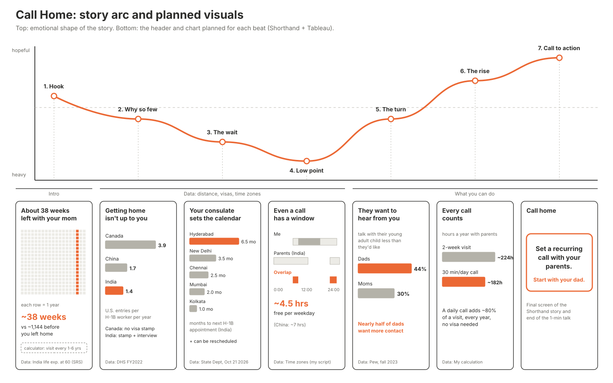

| [home page](https://cmustudent.github.io/tswd-portfolio-templates/) | [data viz examples](dataviz-examples) | [critique by design](critique-by-design) | [final project I](final-project-part-one) | [final project II](final-project-part-two) | [final project III](final-project-part-three) |

# Final Project, Part II: Call Home

**Draft Shorthand story:** [Call Home](https://carnegiemellon.shorthandstories.com/call-home-ashwin/index.html)

In Part I, I proposed a data story about how much in-person time international students have with their parents, and why the phone call matters. This page documents how the story developed in Part II: what changed after instructor feedback, how the sketches became a storyboard and a Shorthand draft, the high-fidelity visualizations, and the user research on the draft.

---

## 1. What changed since Part I

| Change | Reason |
|---|---|
| Reframed the story to be hopeful: "weeks to make count" instead of "weeks left," no language about parents dying, and an uplifting second half | Instructor feedback that some students may become anxious |
| Replaced the single call to action with three concrete actions, led by "call while you cook" | Instructor feedback that strong calls to action help; the cooking call comes from my own routine |
| Added my own experience in first person throughout | Instructor feedback that it can be a personal story |
| Removed Canada as a comparison | The story focuses on families in India and China |
| Removed the Pew chart about U.S. parents | It surveyed U.S. families, so it didn't represent parents in India or China |
| Dropped the planned interactive calculator | Kept the story focused; fixed, clearly labeled assumptions are easier to follow in a short story |
| Kept India's Sample Registration System life tables instead of switching to WHO data | The story focuses on India, and SRS is India's official national source |
| Replaced plain bar charts with visual metaphors (music-player seek bar, planes, calendar pages) | Make the data memorable and easier to read at a glance |

## 2. Storyboard: from sketch to Shorthand draft

### Starting point: the Part I sketch

The Part I sketch mapped the story arc and a planned visual for each beat.

### The storyboard

The story moves from a personal opening, through the data on why visits are rare, to a hopeful turn and concrete actions. Each row is one section of the Shorthand draft, in reading order.

| # | Section | Role in the story | What the reader sees |
|---|---|---|---|
| 1 | **Call Home** | Opening | Title over a plane-window photo; subtitle: "When you study abroad, home is far away. This is a look at how much time we really get with our parents, and how to make the most of it." |
| 2 | **The Space Between Us** | Setting the scene | Distance growing over time, starting at "0 miles apart" with my mother in India and me starting out |
| 3 | **Playing on Fast Forward** | The hook | My own story, with the music-player seek bar: most of my weeks with my mom have already played, and about 38 weeks are left with one visit a year |
| 4 | **Why Only One Visit a Year?** | The challenge | Planes (about 1.4 trips a year) and calendar pages (visa appointment waits of up to 6.5 months), shown as image frames beside scrolling text |
| 5 | **Our Time Zone** | The turn | Timeline of about 4.5 hours a day when my parents and I are both free |
| 6 | **Ways to Stay Close** | Call to action | Three cards: call while you cook, schedule a call, bring them here |
| 7 | **References** | Credibility | Data sources and AI acknowledgement |

### Shorthand draft

### Scenario of use

A graduate student from India scrolls through the story on her phone between classes. The seek bar makes her realize how few weeks with her mom are ahead; the planes and calendar pages explain why visits are so rare; the time-zone chart shows her when she and her parents are both free. At the end she picks one action, calling home while she cooks dinner that evening.

## 3. High-fidelity visualizations

### Music-player seek bar

### Planes

### Calendar pages

### Time together

### Chart elements

| Visualization | Title (takeaway) | Annotations and legend | Data source shown on chart |
|---|---|---|---|
| Seek bar | "Don't skip the last part" | "You are here" marker; weeks so far and "38 weeks to go" labeled at each end | India SRS life tables via Karun et al. (2025), plus stated assumptions |
| Planes | "About one trip a year" | "Each plane = one trip"; partial planes show fractions; note that entries include business trips | DHS OHSS, FY2022 |
| Calendar pages | "Your appointment is months away" | "Each page = one month"; months labeled; total wait per consulate; Hyderabad highlighted | U.S. State Department, Oct. 21, 2026 |
| Time together | "4.5 hours a day that belong to both of you" | Rows labeled; shared hours labeled "morning call" and "evening call" with durations; time axis | My calculation, with assumptions printed under the chart |

**Design rules across all charts:** orange highlights the one number that matters and everything else is gray; every chart has a takeaway headline instead of a descriptive title; every chart prints its source and assumptions underneath.

## 4. User research protocol

### Research goal

Find out what works and what doesn't in the draft story, what questions readers have while reading it, and what new ideas they bring, so I can improve the story in Part III.

### a. Target audience

**Primary:** international students and early-career workers (F-1, OPT, H-1B) in the U.S. whose parents live abroad, especially in India.
**Secondary:** anyone who lives far from their parents.

### b. Research questions

The interviews are built around four questions:

1. **What worked?** Which parts of the story and charts were clear, engaging or memorable?
2. **What didn't work?** Which parts were confusing, slow or unnecessary?
3. **What questions came up?** What did readers wonder about or want explained while reading?
4. **What new inspirations arose?** What ideas did readers suggest for the story or the charts?

### c. Recruiting participants

I am interviewing at least three people, chosen to reflect the audience rather than only close friends:

- At least two international students or workers from the target audience, ideally in different situations (for example, one student and one working professional)
- One person outside the primary audience, to check whether the story makes sense without personal context

Participants are recruited through classmates and personal networks. No names or identifying details are recorded. Each interview takes about 10–15 minutes using the Shorthand draft.

### d. Interview script

**Introduction**
> "Thanks for helping. I'm testing a draft data story for a class project. There are no right or wrong answers. I'm testing the story, not you. It's about time with family, so feel free to skip any question. I won't record your name."

**Walk-through:** the participant scrolls through the full draft and thinks aloud while I take notes.

**Questions**
1. What worked for you in this story?
2. What didn't work?
3. What questions came up while you were reading?
4. What new ideas or inspirations does it give you, for the story or the charts?

## 5. Findings

*Participants are described generally, with no names or identifying details. Interviews are ongoing; this section will be updated as more are completed.*

### Participants

| ID | Description |
|---|---|
| P1 | International student in a Master of Information Systems Management program, 20s |
| P2 | International student in a Master of Arts Management program, 20s |

### Findings by question

**What worked?**
- The topic itself: participants said it was something they hadn't thought about before.
- The animations in the Shorthand story.
- The story overall: participants found it an interesting story to tell.

**What didn't work?**
- The music-player seek bar was not instantly understandable.
- The text next to the flight chart was unnecessary. The planes alone were enough to understand the point.

**What questions came up?**
- No specific questions were raised beyond the confusion about how to read the seek bar.

**What new inspirations arose?**
- Bring Canada back into the flight chart as a comparison, using a car symbol instead of planes, to show how much easier it is to get home when home is a drive away.

### Patterns so far

Both participants are international students in their 20s, part of the story's primary audience. The topic and the animations landed well: participants hadn't thought about this before and found it an interesting story, so the core idea and the Shorthand format are worth keeping. The improvements point in one direction: the visuals should explain themselves with less text, and the most important chart, the seek bar, needs to be readable at first glance.

## 6. Changes planned for Part III

| Finding | Planned change | Reason |
|---|---|---|
| The seek bar is not instantly understandable | Add a short line above it explaining how to read it (for example, "Each bar is every week I'll spend with my mom; orange is what's still ahead"), and test the revised version with the next participants | The hook is the most important chart, so readers need to get it within seconds |
| The text beside the flight chart is unnecessary | Remove the supporting text and let the planes carry the message, keeping only the title and source | Less text makes the chart faster to read |
| Suggestion to include Canada with a car symbol | Add Canada back as a comparison row, using car icons (about 3.9 entries a year for Canadian H-1B workers, DHS FY2022) | A car makes the contrast instant: Canadians can drive home, while workers from India need a long flight and often a visa appointment |

## Sources

Data sources are listed in the References section of the Shorthand story and on the [Part I page](final-project-part-one.md#4-the-data).

**AI acknowledgement:** Charts were created with Claude (Anthropic) using the data listed in the story's references. Claude also helped plan the story structure, draft some section text and draft this page, which I edited. Shorthand's AI companion helped with some of the transitions. 

